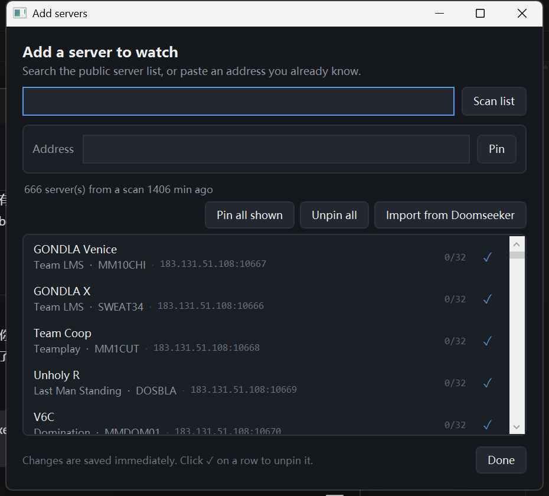
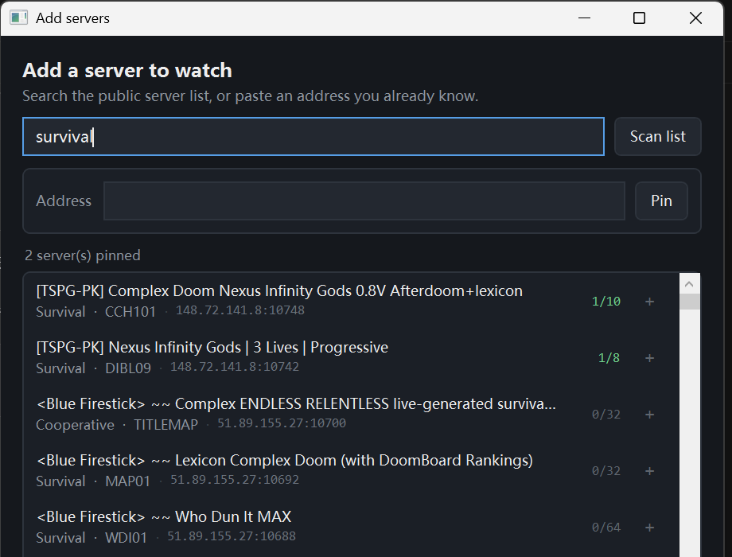
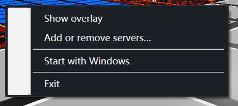

# Zandronum Server Watcher

Watches a handful of Zandronum servers and tells you the moment someone joins one —
so you stop refreshing a server browser waiting for a game to start.


## What it does

- Polls the servers you list on an interval, showing humans on each (bots are excluded)
- Raises a **Windows toast notification** when an empty server gets its first player,
  and optionally when more players join
- Keeps an always-on-top overlay with per-server detail you can expand
- Can run **headless** (`--headless`) for a machine with no desktop session

## Status

- ✅ Master-server listing (Huffman-coded, paginated)
- ✅ Per-server launcher query with player roster
- ✅ Human vs. bot counting
- ✅ Occupancy alerts with offline debounce, delivered as toasts
- ✅ Per-server alert overrides for pinned servers
- ✅ Add-server dialog with search over a cached master scan
- ✅ `--list` / `--pin` / `--unpin` for the same thing from a shell
- ✅ Always-on-top transparent overlay, out of Alt+Tab
- ✅ Tray icon: close hides to tray, so the watcher keeps running
- ✅ Headless mode writing alerts to a log file
- ✅ 78 tests, including end-to-end UDP tests against a fake server
- ⬜ Tray icon and a settings UI

## Requirements

- Windows 10 (build 17763) or 11
- .NET 10 SDK (pinned in `global.json`)

## Build and run

```powershell
dotnet build
dotnet run --project src/ZandronumWatcher.App
```

Run the tests:

```powershell
dotnet test
```

VS Code launch and build tasks are checked in under `.vscode/`. Because the app is a tray
app that keeps running, **exit it from the tray menu before rebuilding** — otherwise the
build fails with "file is being used by another process" when it tries to overwrite the
executable.

Publish:

```powershell
dotnet publish src/ZandronumWatcher.App -c Release -r win-x64 --self-contained false
```

## Adding servers to watch

You only watch the servers you pin — this is not a server browser. Click the **＋** button
in the overlay (or the "No servers pinned yet" prompt on first run) to open the add dialog:



It scans the public master server once, then lets you:

- **Search** by server name, map, game mode or address — filtering is instant because it
  runs against the cached scan
- **Click ＋** on any row to pin it, **✓** to unpin. Changes are saved immediately
- **Paste an address** if you already know it; the port defaults to 10666



Pinned servers sort to the top, then by how many humans are playing, so the servers worth
joining surface first.

The scan is cached in `servers.cache.json` next to the config and reused for 10 minutes.
A full scan queries every advertised server and takes tens of seconds, which would make
searching unusable if it ran on every keystroke.

### From the command line

```powershell
ZandronumWatcher.exe --list          # only servers with players
ZandronumWatcher.exe --list --all    # include empty ones
ZandronumWatcher.exe --pin 148.72.141.8:10718 104.243.34.46:10703
ZandronumWatcher.exe --unpin 104.243.34.46:10703
```

`--pin` and `--unpin` edit `servers.json` in place.

## Configuration

`servers.json` next to the executable:

```json
{
  "pollSeconds": 15,
  "servers": [
    "78.36.200.207:10666",
    {
      "address": "78.82.95.98:10666",
      "alerts": { "onHumanJoins": false }
    }
  ],
  "notifications": {
    "onServerBecomesPopulated": true,
    "onHumanJoins": true,
    "onServerBecomesEmpty": false,
    "onHumanLeaves": false,
    "onServerGoesOffline": false,
    "onServerComesOnline": false
  }
}
```

A server may be a bare `"host:port"` string or an object with `alerts` overrides. The
first two global switches are the useful ones: `onServerBecomesPopulated` is the "0 → 1"
alert, and `onHumanJoins` covers "someone else showed up".

**Per-server overrides matter once you pin more than a couple of servers.** A weekly game
night wants every join; a busy public server would notify constantly. Override
`onHumanJoins: false` on the noisy ones and leave the rest inheriting the global setting.
Unset fields inherit; they are not treated as `false`.

## Why the code looks the way it does

Each of these was found the hard way, by testing against live servers.

**Humans and bots must be counted separately.** Zandronum servers commonly run bots. One
survey of the public list found a server advertising 36 players with zero humans in it.
Counting `SQF_NUMPLAYERS` would produce a permanent false alarm on that server, so
`ServerInfo.HumanCount` counts non-bot roster entries. When a server omits the roster
but reports a player count, that count is used as a fallback.

**A timeout is not an offline server.** Zandronum is UDP and drops queries routinely.
`OccupancyTracker` requires several consecutive failures before declaring a server
offline, otherwise a flaky link generates an endless "offline / online" pair of alerts.

**The first observation is a baseline, not a transition.** Otherwise starting the app
would alert about every already-populated server at once.

**All traffic is Huffman coded.** Both master and game servers expect Doom's Huffman
codec, not plain UDP payloads. The first byte is the padding-bit count, bits are packed
LSB-first, and a leading `0xFF` marks a raw payload. See `Huffman.cs`; the 256-entry
table is generated by `tools/generate-huffman-tables.py`.

**Servers rate-limit repeat queries.** Zandronum ignores queries within roughly 10–12
seconds of the previous one (`sv_queryignoretime`). The default poll interval is 15 s.

**Dead servers are normal.** Around half of the master server's entries do not answer.
Queries use a 2 s timeout and a concurrency semaphore so one dead host cannot stall a
refresh.

**Resolve by name, not by IP.** Proxy setups such as Mihomo TUN hand out fake-IP
addresses in `198.18.0.0/15`; connecting to a hard-coded literal IP bypasses the proxy
and fails.

**A timeout is not "offline".** Zandronum servers stay completely silent while their
query-ignore window is open, so a cold start right after another query gets no answer at all.
That used to render as a red "timed out", which reads like the server is dead. It now shows a
neutral "no reply — retrying", because the next poll almost always succeeds.

**A WinExe has no stdout by default.** The CLI modes call `AttachConsole`, but doing that
unconditionally broke output redirection: `--list > out.txt` produced an empty file and still
exited 0, because attaching replaced the redirect. `ConsoleHost` now inspects the existing
standard handle and only attaches when there is genuinely no console, and forces UTF-8 when
output is redirected (the default ANSI code page turned `·` into mojibake).

**Pin state is one function, not three.** The dialog, the CLI and the overlay all edit the
same list, so the rules live in `PinList`. That paid off immediately: the dialog's
row toggle had been computing the new state as `IsPinned is false`, which is always
`false` for a pinned row — clicking ✓ silently did nothing. `PinListTests` now pins that
behaviour down.

**A full scan is too slow to run on demand.** Querying every advertised server takes tens
of seconds (the list is 600+ entries, half of them dead). The add dialog therefore caches
the scan on disk and searches it in memory; rescanning is a deliberate action, not
something that happens per keystroke.

**Per-server overrides beat one global switch.** Pinned servers are not interchangeable:
one is a weekly game night where every join matters, another is a busy public server where
only the first player is interesting. A single global setting forces the noisiest server to
dictate the behaviour for all of them.

**CLI modes must not block the dispatcher thread.** `--list` and `--headless` run through
`Task.Run`. Blocking the WPF dispatcher on an async call deadlocks, because
`Progress<T>`/continuations post back to that same thread — this showed up as a hang with
no output at all.

**Unpackaged apps need a Start Menu shortcut to show toasts.** Without a shortcut
carrying an AppUserModelID, `ToastNotificationManager` reports success and silently
drops the notification. `AppRegistration` creates that shortcut on startup.

## Tray and closing behaviour

The `✕` button **hides the overlay to the tray** rather than quitting — the watcher has to
stay running to keep sending notifications. The tray icon's menu has:

- **Show overlay** — also triggered by double-clicking the icon
- **Add or remove servers…**
- **Start with Windows** — toggles a per-user Run entry, no admin rights needed
- **Exit** — the only way to actually quit



The autostart toggle matters more than it looks: without it, a reboot silently turns
notifications off until you remember to launch the app again. Same thing from a shell:

```powershell
ZandronumWatcher.exe --autostart on
ZandronumWatcher.exe --autostart status
ZandronumWatcher.exe --autostart off
```

## Headless mode

```powershell
ZandronumWatcher.exe --headless
```

Alerts are appended to `%LOCALAPPDATA%\ZandronumWatcher\watcher.log` and also shown as
toasts. This path touches no WPF types, which is what a Linux host would build on.

## Project layout

```
src/
  ZandronumWatcher.Core/     protocol, polling, alerting; net10.0, no UI dependencies
    Protocol/                Huffman codec, packet reader, response parsers
    Models/                  ServerInfo, PlayerInfo, ServerEndpoint, ...
    Alerts/                  OccupancyTracker, OccupancyChange, IAlertSink
    Configuration/           WatchConfig (pinned list + per-server overrides)
    Services/                ZandronumClient, ServerWatcher, OccupancyMonitor,
                             ServerDirectory, ServerDirectoryCache
  ZandronumWatcher.App/      WPF overlay + toasts + headless host
tests/
  ZandronumWatcher.Core.Tests/   xUnit, incl. a fake UDP server for end-to-end tests
tools/
  generate-huffman-tables.py     regenerates Protocol/HuffmanTables.g.cs
```

`Core` targets plain `net10.0` so the protocol and alerting logic can be tested on any
platform — the test suite runs unchanged on Linux. Only the host project is
Windows-specific.

## License

MIT